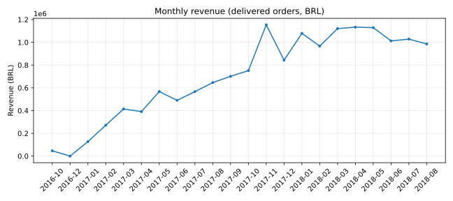
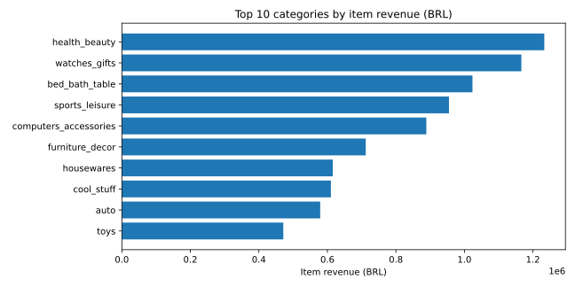
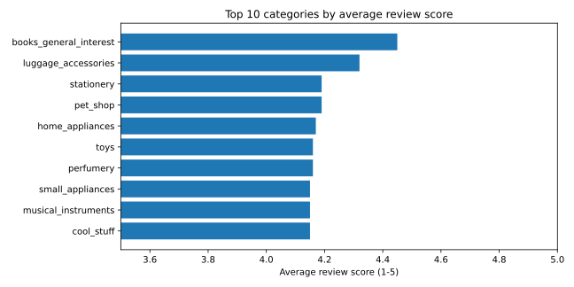

# SQL E-commerce Analytics Dashboard — Brazilian Olist

🚀 **Live demo:** [Try the app](https://7hdfbygbq4tzibzccmp9eu.streamlit.app/)

Twelve SQL questions a marketplace actually asks — answered against a
real multi-table database, with the queries, the numbers, and a
Streamlit dashboard that runs the SQL live.

**Dataset:** Brazilian E-Commerce Public Dataset by Olist — 99,441
orders, 96,096 customers, 2016-09-04 to 2018-10-17.
**Stack:** SQLite + SQL (joins, CTEs, window functions) + Python + Streamlit.

## The answers, in one table

All numbers below come from `sql/*.sql` run against the real database
(see `results/` for every query's output CSV and `results.json`).

| Business question | Answer |
|---|---|
| How much money, in total? | **R$ 15,422,462** revenue from delivered orders |
| How many orders? | 99,441 orders, **96,478 delivered** (97.0%) |
| Average order value? | **R$ 159.86** (delivered orders) |
| Best month? | **2017-11: R$ 1,153,528** (Black Friday month) |
| Top category? | **health_beauty — R$ 1,233,132, 9.3%** of item revenue |
| Top state? | **SP (São Paulo) — R$ 5,770,266, 37.4%** of revenue |
| How do people pay? | **Credit card 78.5%** of revenue (avg 3.5 instalments); boleto 18.0% |
| Are deliveries on time? | Avg **12–13 days** in 2017–18; **only ~6% late**, but the late share rose from 1.5% (2016) to 9.4% (2018) |
| Are customers happy? | Avg review score **4.09 / 5**; books 4.45 (best), office_furniture 3.49 (worst) |
| Do customers come back? | **No — 97.0% ordered exactly once**; repeat customers are 3.0% of customers and 5.6% of revenue |
| Who is worth keeping? | **Champions: 12.8%** of customers, R$ 3.27M; **At risk: 24.5%**, R$ 6.11M — the biggest pool to win back |





## The headline finding

This is not a growth story — it is a **retention** story. Revenue grew
fast (from ~R$ 47k in Oct 2016 to over R$ 1M/month by mid-2018), delivery
is mostly on time, and reviews are good. But **97% of customers never
order a second time**: month-1 cohort retention is typically under 1%.
The business question is not "how do we get more orders?" — it is
"why does nobody come back?" The RFM segmentation says the same thing
from the other side: frequency is ~1.0 in every segment, so the segments
are really separated by recency and spend, not by loyalty.

## The 12 queries

| # | File | Question | SQL used |
|---|---|---|---|
| 1 | `01_monthly_revenue.sql` | Monthly revenue trend | Aggregation, `strftime` |
| 2 | `02_revenue_by_category.sql` | Revenue by category | Join, window `SUM() OVER ()` for share |
| 3 | `03_revenue_by_state.sql` | Revenue by state | Join across customers → orders → payments |
| 4 | `04_top_products.sql` | Top 10 products | Aggregation, `LIMIT` |
| 5 | `05_top_customers.sql` | Top 10 customers by spend | Aggregation, `MIN`/`MAX` |
| 6 | `06_payment_methods.sql` | Payment mix | Window share, `AVG` instalments |
| 7 | `07_delivery_performance.sql` | Actual vs promised delivery | `julianday` date maths |
| 8 | `08_review_score_by_category.sql` | Review score by category | Conditional aggregation |
| 9 | `09_repeat_customers.sql` | Repeat vs one-time customers | CTE, bucketing |
| 10 | `10_rfm_segmentation.sql` | RFM segments | CTEs, `NTILE` quartiles |
| 11 | `11_cohort_retention.sql` | Monthly cohort retention | CTEs, month-offset maths |
| 12 | `12_monthly_growth.sql` | MoM growth, running revenue | `LAG`, running `SUM() OVER ()` |

Reproduce: `python src/run_queries.py` — it runs every query and
rewrites `results/*.csv`, `results.json` and `plots/*.svg`.

## Dataset

Brazilian E-Commerce Public Dataset by Olist
([Kaggle: olistbr/brazilian-ecommerce](https://www.kaggle.com/datasets/olistbr/brazilian-ecommerce),
CC BY-NC-SA 4.0). Real orders from a Brazilian marketplace, 2016–2018.

| Table | Rows |
|---|---|
| customers | 99,441 |
| orders | 99,441 |
| order_items | 112,650 |
| order_payments | 103,886 |
| order_reviews | 99,224 |
| products | 32,951 |
| category_translation | 71 |

**Revenue definition:** `SUM(payment_value)` for orders with
`order_status = 'delivered'` only. Cancelled, shipped-but-not-delivered
and unavailable orders are excluded, so the R$ 15.42M is money for
orders customers actually received.

## Setup

The raw CSVs (~60 MB) and the built database are **not** in this repo.
Download and build them locally:

```bash
python src/build_db.py --download   # fetches the 7 CSVs, builds ecommerce.db
python src/run_queries.py           # runs all 12 queries, writes results/ + plots/
streamlit run app.py                # dashboard (runs the SQL live)
```

`data/samples/` contains 500-row samples of each main table so the
schema can be inspected without downloading anything.

## Project structure

```
├── app.py                  # Streamlit dashboard (live SQL)
├── schema.sql              # table definitions + indexes
├── results.json            # headline numbers (from src/run_queries.py)
├── requirements.txt
├── sql/                    # 01_...12_*.sql — the 12 business queries
├── src/
│   ├── build_db.py         # download CSVs, load into ecommerce.db
│   └── run_queries.py      # run queries, write results/ + plots/
├── results/                # one CSV per query (actual outputs)
├── plots/                  # monthly_revenue, revenue_by_category, review scores
└── data/samples/           # 500-row samples per table
```

## Data quirks found (and handled)

- **814 duplicate `review_id`s:** 99,224 review rows contain only
  98,410 distinct review ids, so `order_reviews` uses a surrogate key,
  not `review_id` as primary key.
- **1 delivered order has no payment record:** 96,478 delivered
  orders, 96,477 with payments. Revenue uses the 96,477.
- **775 orders have no order items** (mostly cancelled/unavailable).
- **No orders at all in 2016-11**, and no delivered orders in
  2018-09/10 — the data ends while late-2018 orders were still in transit.
- Estimated delivery dates are generous: orders arrive **11–19 days
  before the estimate on average**, which is why only ~6% count as late.

## Limitations

- The data ends in Oct 2018; nothing here describes Olist today.
- Revenue is payment value, not profit — no costs, refunds or seller
  fees are in the data, so margins cannot be computed.
- RFM frequency is ~1.0 in every segment (almost nobody repeats), so
  the segments separate customers mainly by recency and spend.
- Review scores are self-selected: unhappy customers are more likely
  to leave a review than satisfied ones.
- This is an independent educational analysis, not an official
  Olist report.
